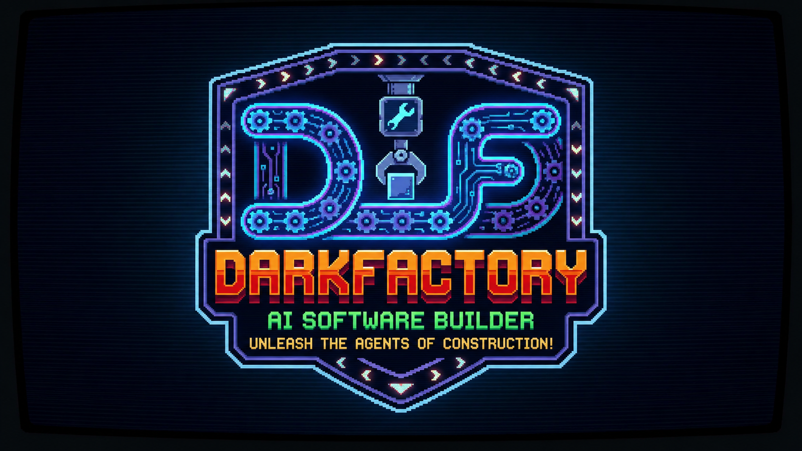

# Dark Factory Skills — Unleash the agents of construction!



**Senior-engineer discipline for AI coding agents.**

Dark Factory gives an AI coding agent the workflows a senior engineer follows by habit: align before building, work in small verified steps, prove it runs, review for correctness, and ship with a way back. Fifteen skills cover the full development lifecycle and activate on their own when a task calls for them, so the right discipline runs at the right moment. For larger jobs, an optional autonomous workflow runs that whole lifecycle end to end from a single planning checkpoint.

> **New here? Start with the [User Guide](docs/USER_GUIDE.md)** — installation, the mental model, a full worked example, and recipes for everyday workflows.

```
 DEFINE        BUILD                 VERIFY            REVIEW              SHIP
┌────────┐   ┌──────────────────┐   ┌────────────┐   ┌──────────────┐   ┌────────────┐
│architect│→ │incremental-impl  │→  │tdd         │→  │code-review   │→  │git-and-ship│
│         │  │ui-engineering    │   │runtime-veri│   │simplification│   │            │
│api-design│ │source-driven     │   │debugging   │   │security      │   │            │
└────────┘   └──────────────────┘   └────────────┘   │performance   │   └────────────┘
   /architect      /build              /test          └──────────────┘      /ship
                                                          /review
```

## Principles

- **Focused.** Each skill covers a distinct phase of building software — nothing overlaps, nothing competes for the same job.
- **Workflows, not suggestions.** A skill is a process the agent follows in order, and verification is never optional.
- **You keep the judgment.** Skills surface decisions and trade-offs; the developer makes every call.
- **Polyglot.** Testing, security, and API guidance cover both TypeScript and Python.

## Skills (15)

| Phase | Skill |
|-------|-------|
| Meta | `using-skills` — discovery and always-on operating behaviors |
| Define | `architect` — align, decide, produce a short spec and plan |
| Define | `api-and-interface-design` — stable, hard-to-misuse contracts |
| Build | `incremental-implementation` — thin, verified vertical slices |
| Build | `ui-engineering` — production UI with a consistency registry |
| Build | `source-driven-development` — APIs verified against current docs |
| Verify | `test-driven-development` — failing test first |
| Verify | `runtime-verification` — behavior confirmed against the real runtime |
| Verify | `debugging-and-recovery` — root cause and failure-mode triage |
| Review | `code-review` — five-axis review that reports, never auto-fixes |
| Review | `code-simplification` — clarity over cleverness, behavior preserved |
| Review | `security-and-hardening` — input, access control, secrets |
| Review | `performance-optimization` — measure first, optimize what's proven |
| Ship | `git-and-shipping` — atomic commits, launch checklist, rollback plan |
| Sustain | `memory-and-context` — session save/restore and lightweight ADRs |

## Personas (4)

`code-reviewer` · `security-auditor` · `test-engineer` · `performance-auditor` — fresh-context sub-agents, each reviewing your work from a single perspective. Slash commands invoke them; they never invoke each other. `/ship` fans them out in parallel (performance only when the change is user-facing) and merges their findings into one go/no-go decision. Details: [docs/PERSONAS.md](docs/PERSONAS.md).

## Commands (6)

`/architect` · `/build` · `/test` · `/review` · `/ship` · `/darkfactory`

## Autonomous workflow

For a single feature or a whole app, `/darkfactory` runs the full lifecycle in one go: it aligns on a blueprint with you, and once you approve it, builds → tests → fixes → reviews milestone by milestone on its own — stopping only when the work meets its acceptance criteria or a decision genuinely needs you. It is opt-in: off by default, engaged per project, and portable across any agent tool. See the [workflow guide](docs/WORKFLOW.md).

## Install (Claude Code)

```
/plugin marketplace add alenberlin/DarkFactory-skills
/plugin install darkfactory@darkfactory-skills
```

The `SessionStart` hook loads the `using-skills` meta-skill automatically at the start of every session.

## License

[Apache License 2.0](LICENSE) © 2026 [Alen Mikic](https://alen-ai.com) — see [NOTICE](NOTICE).

Free to use, modify, and distribute under Apache 2.0. Redistributions must keep the `LICENSE` and `NOTICE` (with your changes noted). If you demo or build on these skills, a credit to **Alen Mikic — [alen-ai.com](https://alen-ai.com)** is appreciated, though not required.
