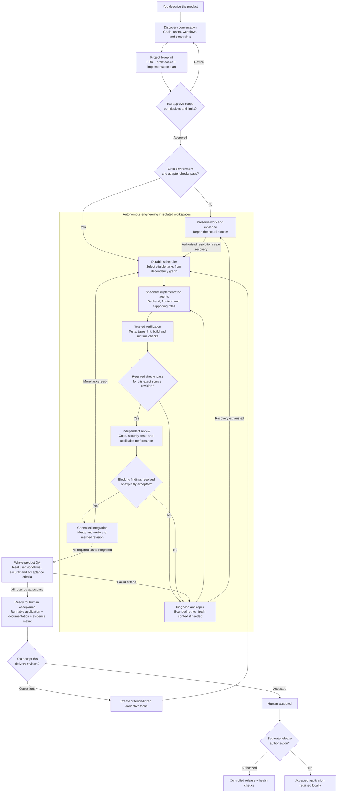
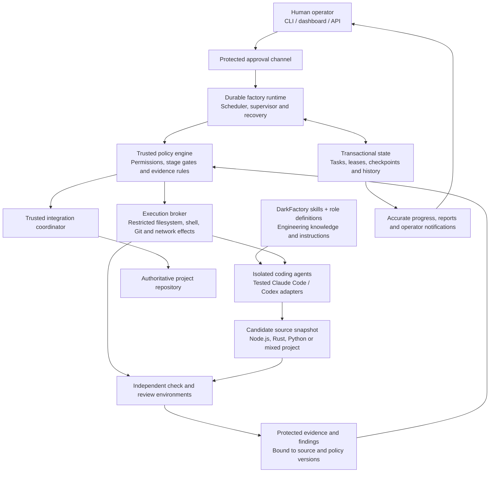

# DarkFactory Autopilot — workflow and architecture map

This map describes the approved design. Implementation status and test results
are tracked separately; the diagram does not certify that a component is built.

## The complete workflow

Independent tasks may run concurrently. Tasks depending on blocked work remain
unscheduled. An incomplete or blocked project cannot pass final acceptance gates.

## What keeps the workflow operating and controlled

Skills guide engineering decisions. The runtime keeps authorized work moving
and survives interruptions. The policy engine decides whether operations and
transitions are permitted. Agents cannot grant themselves approval or certify
their own completion. The project's language selects its toolchain; the
surrounding workflow stays the same.

See the [approved blueprint](BLUEPRINT.md), [architecture](ARCHITECTURE.md) and
[implementation plan](IMPLEMENTATION_PLAN.md) for the detailed contracts.
