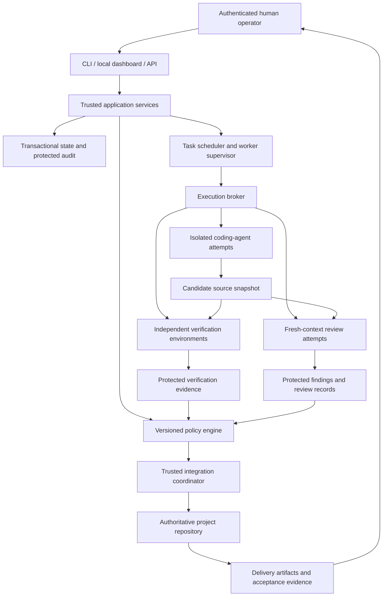

# DarkFactory Autopilot technical architecture

Blueprint version: 1 · Status: proposed; implementation and conformance pending

## Architecture decisions

Use a single-host modular application with a separate supervised worker process.
Keep orchestration, policies, adapters, verification, storage and presentation
behind typed interfaces. Target-project languages do not determine the factory's
implementation language.

| Decision | Selected approach | Rationale and boundary |
| --- | --- | --- |
| Runtime | Python, typed modules and explicit subprocess supervision | Integrates process, filesystem and transactional state handling; Node.js or Rust could also implement the same contracts |
| Persistence | SQLite, local disk, explicit migrations and short transactions | Fits one-host ownership; durable scheduling is implemented against transactions, not in-memory background tasks |
| HTTP/API | FastAPI and Pydantic models | Shared validated contracts and generated OpenAPI; CLI and dashboard use the same services |
| CLI | Python command entry point, argument parsing and JSON output | Headless operation remains complete without dashboard or browser |
| Dashboard | Local HTML/CSS/JavaScript, served by the API | Actual state, accessible controls and local assets; a separate frontend framework is not required |
| Execution | Docker backend with explicit mounts, privileges and networking | Effect-based boundaries constrain untrusted commands independent of their spelling or provider hooks |
| Scheduling | Database-backed task graph, leases and operation journal | A compact single-host design with explicit crash recovery; a separate distributed workflow service is unnecessary for this host scope |
| Git | Controller-owned integration repository and task worktrees | Agent changes are candidates, with integration owned by a trusted coordinator |
| Verification | Protected definitions, immutable source snapshots and independent executors | Evidence matches the code actually verified; agent-reported results are untrusted |
| API evolution | Versioned JSON schemas and API routes | Adapters and future clients depend on explicit contracts; generated clients are regenerated if introduced |

FastAPI supplies typed validation and OpenAPI integration; this does not itself
implement authorization or durable workers. See [FastAPI features](https://fastapi.tiangolo.com/features/).

SQLite WAL supports concurrent readers and one writer on the same host. Use
`synchronous=FULL`, bounded busy handling and the supported backup API. Require a
SQLite version containing the WAL-reset fix (3.51.3 or later, or a verified fixed
backport); check the linked runtime library during preflight. The inspected host
reports SQLite 3.53.3. See [SQLite WAL documentation](https://www.sqlite.org/wal.html).

Exact dependency and image versions are selected, locked and tested during the
foundation task. A Python version number alone does not establish SQLite safety.

## Components and trust boundaries



The language model proposes work and assessments. Trusted services own identity,
approvals, job ownership, privileged effects, evidence and gate decisions.
Project documents, package scripts, model responses and browser output cannot
modify this authority.

## Proposed repository organization

```text
skills/                         Existing skills plus factory-specific skills
agents/                         Four retained personas plus ten role definitions
commands/                       Existing commands plus a factory router
src/darkfactory/
  domain/                       Versioned contracts and state transitions
  storage/                      Migrations, transactions, leases and audit
  policy/                       Schema validation and gate decisions
  execution/                    Broker, sandbox, snapshots and operation journal
  adapters/                     Provider/CLI capability and protocol adapters
  workflow/                     Discovery, planning, scheduling and remediation
  verification/                 Check executors, reviews and acceptance matrix
  integration/                  Managed Git operations and merged verification
  interfaces/                   CLI and API, using shared application services
  web/                          Optional dashboard and local static assets
schemas/                        Published policy/task/evidence/adapter schemas
profiles/                       Proposed language/toolchain defaults
tests/                          Unit, integration, subprocess, sandbox and E2E
examples/                       Configuration and project-board pilot artifacts
docs/autopilot/                 Blueprint, operational docs and delivery evidence
```

Directories are created when their implementation task needs them. Do not ship
empty scaffold modules or claim an unimplemented interface is working.

## State and data model

Store projects, immutable blueprint versions, approval records, requirement IDs,
tasks and dependency edges, role/model configuration, attempts, worker leases,
checkpoints, operation intents, source manifests, check definitions and runs,
review findings and resolutions, exceptions, usage reservations, audit events,
delivery revisions and final acceptance in transactional tables.

Use stable IDs, foreign keys, uniqueness constraints, schema versions and UTC
timestamps. Monetary values use exact units; unknown usage is represented as
unknown. A state change and its audit event commit together. Use a transactional
outbox for work/events that must be delivered after commit. Consumers handle
duplicate event delivery using operation IDs.

Markdown artifacts are human-readable exports from this state. Editing an
export cannot approve a blueprint, pass a check or complete a task. Existing
`PLAN.md` references can point to/export the canonical `IMPLEMENTATION_PLAN.md`
through a documented compatibility path.

Project lifecycle:

`DRAFT → DISCOVERY → AWAITING_BLUEPRINT_APPROVAL → READY → RUNNING → VERIFYING → FINAL_QA → READY_FOR_HUMAN_ACCEPTANCE → ACCEPTED`

Also support `PAUSING`, `PAUSED`, `BLOCKED`, `FAILED`, and `CANCELLED`, with
documented legal return transitions. Release authorization and release outcomes
are separate records. Approved scope changes create a new blueprint version and
invalidate affected approvals/evidence rather than silently editing the old one.

Task lifecycle:

`PENDING → READY → LEASED → IMPLEMENTING → VERIFYING → IN_REVIEW → READY_TO_INTEGRATE → INTEGRATED`

Failure branches include `REPAIR_REQUIRED`, `BLOCKED`, `FAILED`, and `CANCELLED`.
Implementation agents propose completion; only the policy engine may authorize
the transition. Rejected human acceptance creates corrective tasks linked to the
original criteria and a new delivery revision.

## Durable execution and recovery

Claim ready work in a transaction. Assign an attempt ID, lease expiry and fencing
token before spawning a process. Heartbeats extend only the current lease. Late
or duplicated results cannot mutate a task after ownership changes.

Persist each operation's intent before executing it, then reconcile actual state
before recording completion. Local Git operations are checked against branch
references and source identities after a crash. An uncertain external operation
is never blindly retried. Unsupported external operations are denied.

Recovery classifies code defects, polluted context, missing infrastructure,
provider outages, resource exhaustion and foundational decisions separately.
Use bounded retries per strategy with recorded diagnostics; fresh sessions load
the approved task context. Independent tasks may continue while dependencies of
a blocked task remain unschedulable. A foundational blocker prevents delivery.

The worker is a real process independent of the client. Provide operator-installable
launchd and systemd examples, plus a foreground/service command for other
supervisors. Installation into global service directories is an explicit
operator action. Recovery tests use terminated processes and restarted workers;
machine-reboot recovery receives a separately identified operational test.

## Agent and provider contracts

Each adapter declares instruction/skill loading, structured input/output,
tool mediation, shell/filesystem restriction, session restoration, background
execution, usage reporting and log capabilities. Capability records include the
adapter version, tested CLI/provider versions and supported security modes.

Each assignment contains role, task, approved blueprint/policy identities,
requirement IDs, source baseline, permitted paths/actions, verification
expectations, prior failures and bounded relevant source. Reviews get the actual
snapshot and criteria, not exclusively an implementation summary.

Claude Code is a first-class adapter using its noninteractive interface and the
retained skill ecosystem. The inspected CLI exposes `--print`, structured output,
schema output, tool selection and explicit settings sources. Programmatic output
and session behavior must be parsed and tested for the actual installed version.
See [Claude Code programmatic execution](https://code.claude.com/docs/en/headless).

The inspected Codex CLI exposes `exec`, JSONL output, output schemas, sandbox
selection and session resume. These were verified using local `--help`; flags
are feature-probed again by the adapter. CLI session persistence is optional
because authoritative factory context permits fresh-session rehydration.

Native CLIs execute within broker-created environments. Disable inherited hooks,
MCP servers, tools and configuration where the chosen adapter mode requires it.
Provider-native restrictions supplement external isolation. No configuration
may obtain Strict status from permission flags or a prompt alone.

Strict admission for a native CLI requires proof of credential isolation and
restricted egress. An inference gateway holds provider credentials in trusted
storage and supplies only task-scoped inference access to the isolated process.
The gateway validates destinations, request types, model choices and resource
limits; it cannot proxy arbitrary URLs, expose human API control, or return
credentials. Existing personal authentication directories are never mounted
into an agent container. Provider-incompatible authentication modes are declared
unsupported for Strict rather than quietly using host credentials.

Structured proposal execution through the broker is also supported: an adapter
returns validated file/command requests instead of performing privileged effects
itself. All results and proposed tool requests remain untrusted input. Tests may
use deterministic fixture agents for protocol/recovery coverage; the real pilot
must identify its real provider/agent and cannot use such fixtures as proof of AI
engineering.

## Language/toolchain profiles

A profile defines approved image/toolchain identities, setup commands, lockfile
rules, check definitions, expected outputs and runtime probes. Project authors
may propose a profile; trusted administration validates and activates it.

- Node.js/TypeScript: project-selected package manager, package scripts and
  explicit test/lint/type/build definitions.
- Rust: Cargo workspace configuration, actual build/tests, formatting and
  configured analysis checks.
- Python: project-selected dependency manager, test runner, linter, type checker
  and build/packaging checks.

Mixed-language projects combine profiles and dependencies in the same task DAG.
Never invent a passing type check for a language/project without a configured
check. A justified non-applicable check is explicit policy data approved before
execution. Missing required tooling is a preflight failure.

## Execution broker and Strict isolation

The broker issues capabilities for task-local effects and performs privileged
Git/integration/verification actions itself. Shell access inside a disposable
task environment is scoped to that environment; spelling a command differently
does not grant access to the host or authoritative project.

Strict containers run as non-root, with a read-only system filesystem, dropped
capabilities, no privilege escalation, resource limits and no Docker socket or
host administrative mounts. Use only dedicated task source volumes and explicit
read-only inputs. Agent containers cannot reach controller APIs, approval
channels, audit storage, other projects or host home directories. The broker
collects candidates through validated file manifests that reject traversal,
symlink escape, protected-path writes and unsafe file types.

Untrusted application/test execution uses separately constrained containers.
Default networking is denied. Approved package acquisition and model inference
use separate scoped routes, identities and logs. A test application's private
network may connect only the required application and trusted verification
driver; it exposes no controller endpoints or external credentials.

Docker provides read-only filesystems, capability controls and resource/network
options, but the complete boundary needs explicit configuration and tests. See
[Docker container execution options](https://docs.docker.com/reference/cli/docker/container/run/)
and [Docker Engine security](https://docs.docker.com/engine/security/).

Host administrators, the trusted controller and the container engine are trusted
components. Kernel/container escapes, malicious host administrators and hardware
compromise are outside this release's guarantee. Network/identity/filesystem
probes must be actual boundary tests, not assertions about agent compliance.

## Policy engine and verification integrity

Policies are schema-validated, versioned records activated through a separate
administrative identity. The runtime maps every mandatory engineering rule to a
mechanical check, evidence gate or judgment-based review. Policy failure returns
structured policy IDs, failed prerequisites, remediation and evidence links.

Evidence includes task/requirement IDs, immutable source digest and Git reference
when present, blueprint and policy versions, protected check-definition digest,
toolchain/image identity, executed arguments, executor identity, timing, exit
status, relevant parsed results and immutable artifact references. Content
digests cover source, tests, lockfiles and configuration; admin-defined generated
outputs are excluded deliberately. Changing relevant input invalidates evidence.

Required verification executes from the immutable candidate, never a mutable
working directory. The trusted controller creates check records from executor
outcomes; agents cannot submit a success flag. Capture failures and aborted runs
as well as successes. Integration re-verifies the actual merged candidate.

Protected acceptance tests and runner definitions cannot be replaced by an
implementation agent. New agent-written tests are candidates reviewed and
promoted through a distinct role/policy path. Runner changes, baseline test
removal, skipped tests, changed discovery/configuration and suspiciously empty
results prevent silent green gates. Exit status alone is insufficient for a
mandatory acceptance check.

Running unit tests that import untrusted code has different guarantees from
independent black-box checks. Execute generated code in its own boundary, and
use a separate protected driver for critical observable acceptance behavior.
Claim only the check actually exercised. Review addresses semantic weakening
and requirements coverage that mechanical fingerprints cannot prove.

Independent review records include assigned reviewer role/attempt, exact source
identity, examined areas, uncovered areas, verdict and findings. The same model
may serve different roles, but an implementation attempt cannot certify its own
review independence. Blocking findings need remediation and renewed review or
an authenticated, explicit, revision-scoped exception. The orchestrator cannot
erase or resolve a finding merely because it disagrees.

## Approval, API and audit security

Human operations use a dedicated administrative channel inaccessible to agent
environments. Bind approvals to action, project, revision, blueprint digest,
policy version, permission scope and human identity. Prevent replay; reject
agent-role credentials, fabricated actor headers and arbitrary result files.
Human acceptance is only exposed through this channel.

The API binds to loopback by default with authenticated mutations, permitted
Host/Origin checks, CSRF protection for cookie-based dashboard actions, input
validation and no credential values in responses. Remote access requires an
explicit authenticated transport configuration. Project HTML/log content is
escaped, never executed as dashboard markup or policy instructions.

Controller-owned policies, approvals, database and evidence live outside target
agent-writable workspaces. Append audit events transactionally, hash-chain them
for tamper detection and protect the store using the execution boundary. A hash
chain alone is not tamper resistance against an actor able to rewrite all data.
Store backup/checkpoint instructions and failure diagnostics; secrets are
redacted before logs and artifacts are persisted.

## Modes and capability admission

| Mode | Quality/workflow behavior | Execution guarantee |
| --- | --- | --- |
| Advisory | Reports quality violations without blocking those quality transitions | Explicit authorization boundaries still apply; no claim of comprehensive isolated enforcement |
| Enforced | Blocks missing mandatory quality evidence and approvals | Uses declared broker controls; limitations are explicit; does not qualify for unattended Strict execution |
| Strict | Enforced gates plus mandatory restricted execution, protected state and credentials | Requires successful environment/adapter conformance; unavailable capability blocks start |

Normal project policy can select Enforced. Unattended execution defaults to
Strict and cannot automatically downgrade. No mode permits agent-forged human
acceptance, unapproved release, or actions outside the operator's authorization.

Publish a compatibility matrix by host, toolchain, adapter/version, authentication
method and mode. Distinguish tested support, partial support and unsupported
configurations. The initial blueprint describes targets; it does not pre-certify
the installed Claude Code, Codex or Docker configuration.

## Accounting, notifications and delivery

Reserve token/monetary capacity before dispatch and account for concurrent work
and repair attempts. Version any operator-provided pricing data. Report measured
usage separately from estimated charges; provider/CLI estimates are not actual
billing guarantees. Unavailable metrics remain unknown. Enforce resource limits
through trusted observation/proxy controls and stop new work when limits cannot
be proved. Preserve state on budget pause and require authorization to increase
limits.

Dashboard/API event feeds report actual transitions. Configured operator
notification sinks may report completion, failure or required action; external
communication requires its own permission and is disabled by default.

Delivery exports the required documents, setup instructions, lockfiles,
migrations, tests, reports, known limitations and requirement-to-evidence matrix.
READY_FOR_HUMAN_ACCEPTANCE requires all mandatory criteria and blocking findings
to be resolved for the delivery revision. ACCEPTED requires authenticated human
sign-off. Release remains separately authorized and unsupported release adapters
fail closed.
