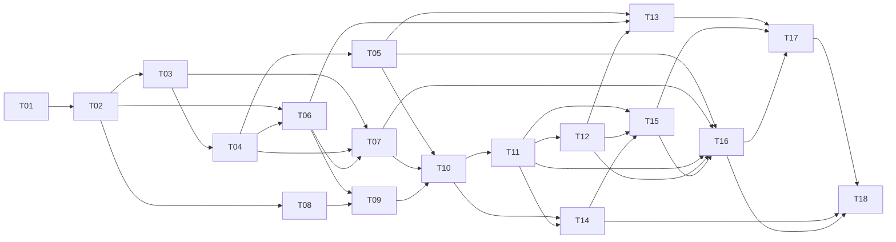

# DarkFactory Autopilot implementation plan

Blueprint version: 1 · Status: proposed, not yet executing

Tasks are logical dependency units, not time estimates. Implementation starts
only after this blueprint is explicitly approved. Each task becomes a structured
runtime record with the fields below, immutable evidence references, and actual
status. No task in this document is complete merely because it is described.

## Shared task contract

Every task records ID, description, requirement IDs, dependencies, assigned role,
deliverables, affected components, acceptance criteria, required checks, security
considerations, source identity and completion evidence. Subtasks preserve the
parent requirement mappings. Test-first work records the relevant failing
reproduction and passing verification when applicable.

Plans may record technical complexity/risk for role routing and dependency
analysis. Do not express human effort or duration estimates, or choose a lower
quality implementation because it appears easier to build.

For each implementation slice: run the narrowest meaningful check, implement,
rerun that check, then run the applicable typecheck, lint, tests and build. Use
real process, filesystem, Git and container boundaries for integration/security
claims. Independent review and re-verification precede integration. Source
commits occur only under explicit authorization.

## Dependency graph

Parallel branches are allowed only when component ownership and execution
permissions permit them. The diagram expresses scheduling eligibility, not
permission for an agent to create unassigned work.

## T01 — Package and engineering foundation

- Role: release engineer. Dependencies: none, after blueprint approval.
- Requirements: FR-001, FR-036. Components: package configuration, `src/`, tests,
  developer tooling, contribution documentation.
- Deliver: typed package entry point, locked dependencies, migrations/test
  infrastructure, lint/type/test/build commands and preserved licensing.
- Acceptance: clean installation and commands run against actual code; no
  unrelated assets or individual skills are removed.
- Tests/evidence: package installation/build smoke, initial narrow unit tests,
  configured lint/typecheck and test results with source identity.
- Security: no secrets or global service installation; dependencies are pinned.

## T02 — Versioned domain contracts and policy transitions

- Role: software architect. Dependencies: T01.
- Requirements: FR-003, FR-005, FR-017, FR-018, FR-020, FR-033.
- Components: domain models, published schemas, policy evaluation, task DAG.
- Deliver: project/task states, requirement/task/evidence/approval contracts,
  policies and structured gate/remediation decisions.
- Acceptance: malformed contracts, cycles, duplicate IDs, missing requirement
  coverage and illegal/stale transitions are rejected; modes are explicit.
- Tests/evidence: schema round trips, DAG validation, transition decision tables,
  missing/stale-evidence failures and generated-schema validation.
- Security: no evaluation of arbitrary policy code; unknown requirements fail closed.

## T03 — Protected storage, approval identity and audit

- Role: backend engineer with independent security review. Dependencies: T02.
- Requirements: FR-006, FR-007, FR-013, FR-026, FR-030.
- Components: migrations, transactions, administrative API, audit/event outbox.
- Deliver: protected versioned blueprint approvals, permission records, append-only
  event APIs, finding/evidence tables and backup/recovery behavior.
- Acceptance: fake human identities, replayed/mismatched approval, agent-role
  approval and nontransactional status/audit updates are denied.
- Tests/evidence: actual database reopen, approval authorization/replay tests,
  rollback/outbox tests and tamper-detection diagnostics.
- Security: human administration is separated from worker/task capabilities;
  active policy changes require separate administration.

## T04 — Execution broker and Strict boundary prototype

- Role: release engineer and security auditor. Dependencies: T03.
- Requirements: FR-019, FR-020, FR-025, FR-026, FR-028.
- Components: execution backend, Docker configuration, candidate collection,
  protected storage separation and inference gateway.
- Deliver: controlled task environments, execution capabilities, safe argv/path
  handling, resource/network limits and startup capability admission.
- Acceptance: real attempts cannot access protected host files, controller APIs,
  other projects, credentials, Docker socket or authoritative Git; unsupported
  Strict environments refuse start without downgrade.
- Tests/evidence: Docker boundary probes, traversal/symlink tests, restricted
  network/privilege/resource tests and credential-gateway conformance results.
- Security: no inherited personal provider configuration, dangerous mounts or
  unrestricted proxy. Failure here prevents unattended execution later.

## T05 — Immutable snapshots and trusted verification

- Role: test engineer. Dependencies: T04.
- Requirements: FR-003, FR-021, FR-022, FR-024.
- Components: snapshot manifests, protected check definitions, check executors,
  artifact store and requirement evidence.
- Deliver: real build/test/static/runtime execution records; protected independent
  acceptance checks; preserved failure and aborted-run evidence.
- Acceptance: agent claims cannot create passing records; changed source,
  weakened/deleted baseline tests, no-op runners and empty required execution do
  not pass mandatory gates.
- Tests/evidence: real failing/passing programs, snapshot mutation/staleness,
  runner substitution, protected test removal and separate driver checks.
- Security: generated code executes inside its boundary; evidence collectors and
  protected acceptance drivers retain distinct authority.

## T06 — Claude Code and Codex adapters

- Role: backend engineer. Dependencies: T02, T04.
- Requirements: FR-008, FR-015, FR-028.
- Components: adapter contracts, CLI process launchers, event parsers and
  version/capability probes.
- Deliver: structured assignments/results, cancellation, bounded output,
  fresh-session rehydration, explicit configuration and compatibility records.
- Acceptance: both adapters handle the actual declared protocol; malformed
  output and unsupported capabilities cannot become successful completion;
  Strict credential/network conformance is required per adapter.
- Tests/evidence: parser cases, actual fixture subprocess interruption/protocol
  tests, feature probes, and separately labeled live adapter runs when authorized.
- Security: provider output is untrusted; no blanket host shell fallback or
  automatic personal credential-directory mounts.

## T07 — Durable scheduler, supervision and budgets

- Role: factory orchestrator and backend engineer. Dependencies: T03, T04, T06.
- Requirements: FR-010, FR-013, FR-014, FR-015, FR-016, FR-027.
- Components: worker entry point, leases/fencing, process lifecycle, operation
  journal, usage reservations and recovery classification.
- Deliver: ready-task claiming, heartbeats, checkpoints, safe pause/resume/cancel,
  bounded retries, actual worker restart and resource accounting.
- Acceptance: stale workers cannot publish results, duplicate scheduling cannot
  duplicate effects, disconnect does not stop a supervised run, and budget
  exhaustion preserves state without scheduling unauthorized extra work.
- Tests/evidence: kill/restart actual workers; concurrency, stale-lease, duplicate
  event, outage, output-limit and reservation/exhaustion tests.
- Security: capability lifetime follows lease ownership; resource usage and
  unknown charges are not fabricated from agent declarations.

## T08 — Upgrade skills, commands and 14 roles

- Role: documentation engineer and software architect. Dependencies: T02.
- Requirements: FR-001, FR-007, FR-008, FR-025, FR-032.
- Components: all existing skills, nine new skills, ten new role files, retained
  personas, command wrappers, orchestrator, hook, manifests and guides.
- Deliver: consistent runtime handoff and approval semantics, role input/output
  contracts, language-neutral guidance and standalone interactive compatibility.
- Acceptance: 24 skills and 14 roles route coherently; no instruction claims that
  loading skills establishes enforcement or durable execution; final acceptance
  and release stay separate.
- Tests/evidence: skill/frontmatter/reference/manifest validation, hook execution
  and realistic workflow checks against approved, blocked and resumed tasks.
- Security: preserve project opt-in and existing invocation policy; do not alter
  global agent configurations or silently grant commits/deployment.

## T09 — Discovery, architecture and executable planning

- Role: product analyst, software architect and implementation planner.
- Dependencies: T06, T08. Requirements: FR-002, FR-003, FR-004, FR-005, FR-008.
- Components: interactive intake, schema-validated model artifacts, blueprint
  generation and dependency-aware plan validation.
- Deliver: adaptive discovery, PRD/architecture/design/plan exports and versioned
  task definitions with complete requirement/verification coverage.
- Acceptance: unresolved material decisions remain visible; an invalid plan is
  rejected and repaired; implementation cannot start before protected approval.
- Tests/evidence: intake-to-blueprint protocol tests and authorized live discovery,
  invalid/cyclic/incomplete plans, versions and requirement coverage.
- Security: generated documents cannot activate policies, approve themselves or
  install privileged tools from embedded instructions.

## T10 — First real end-to-end factory slice

- Role: factory orchestrator, implementation and test roles.
- Dependencies: T05, T07, T09. Requirements: FR-006, FR-007, FR-009, FR-021, FR-030.
- Components: shared application services and initial CLI execution flow.
- Deliver: intake, blueprint, protected approval, one real source task, trusted
  tests, persisted results, worker restart and a truthful report.
- Acceptance: denied-before-approval and successful-after-approval paths work;
  source changes and evidence survive process restart. No decorative dashboard
  substitutes for this slice.
- Tests/evidence: actual isolated implementation/check execution and database
  reopen; live agent execution is identified separately from fixture agents.
- Security: completion depends on trusted gate evaluation, not model output.

## T11 — Independent review and automatic remediation

- Role: code reviewer, security auditor, test engineer, performance auditor and
  assigned repair engineer. Dependencies: T10.
- Requirements: FR-009, FR-023, FR-024, FR-025.
- Components: review assignments, finding/resolution lifecycle and repair scheduler.
- Deliver: independently attributed reviews, protected blocking findings,
  criterion-linked repairs, bounded alternative strategies and re-review.
- Acceptance: blocking findings persist across disagreement/restart; only
  verified remediation or authorized scoped exceptions resolve them; exhausted
  repair becomes blocked and permits safe independent work.
- Tests/evidence: real defective source/reproduction checks, vulnerability cases,
  reviewer independence and ignored/forged finding-resolution attempts.
- Security: the reviewer cannot rewrite implementation and self-approve it in
  the same attempt; exception scope is revision and policy bound.

## T12 — Parallel worktrees and controlled integration

- Role: factory orchestrator and release engineer. Dependencies: T11.
- Requirements: FR-010, FR-011, FR-012, FR-014.
- Components: managed Git, worktree ownership, conflict workflow and merge checks.
- Deliver: independent task branches, overlap serialization, candidate integration,
  conflict handling, interrupted-operation reconciliation and safe cleanup.
- Acceptance: concurrent tasks preserve each other's work; only the coordinator
  updates integration; merged source is reverified; interrupted Git is reconciled.
- Tests/evidence: actual local Git worktrees, overlapping changes, conflicts,
  interrupted integration, stale evidence and protected-branch access attempts.
- Security: fixture commits need authorization; never force-push or delete
  unrecorded work, and never accept task-branch checks as merged-revision evidence.

## T13 — Node.js, Rust and Python project profiles

- Role: test engineer and release engineer. Dependencies: T05, T06, T12.
- Requirements: FR-019, FR-021, FR-024, FR-029.
- Components: versioned profiles, toolchain images, setup and verification definitions.
- Deliver: project-selected commands, actual toolchain checks, locked dependencies
  and mixed-project requirement mapping.
- Acceptance: equivalent small real tasks/checks execute for each language;
  missing tools fail preflight; changes to profile/runner identity invalidate evidence.
- Tests/evidence: real Node.js/TypeScript, Cargo and Python execution, failing and
  passing behavior, and documented tested versions.
- Security: package installation uses approved acquisition paths; generated
  scripts cannot access host secrets or disable protected acceptance drivers.

## T14 — Complete CLI/API and operational dashboard

- Role: backend engineer and frontend engineer. Dependencies: T10, T11.
- Requirements: FR-016, FR-027, FR-030, FR-031.
- Components: CLI, versioned API, dashboard, event feed and operator notifications.
- Deliver: all required commands/controls, PRD/plan/evidence viewers, DAG/pipeline,
  logs, usage and authenticated human actions.
- Acceptance: headless operation is complete; CLI/API/dashboard derive decisions
  and status from the same services; keyboard/error/empty/loading behavior works.
- Tests/evidence: API authorization/contract tests, actual browser control flows,
  disconnect/reconnect and rendered-state comparisons to database records.
- Security: content escaping, Host/Origin validation, CSRF, protected human channel,
  redacted output and explicitly authorized notification sinks.

## T15 — Delivery, final acceptance and correction cycles

- Role: acceptance auditor and documentation engineer. Dependencies: T11, T12, T14.
- Requirements: FR-003, FR-024, FR-032, FR-033, FR-034.
- Components: acceptance matrix, delivery exports, human sign-off and corrections.
- Deliver: complete documents and runnable delivery; acceptance/rejection actions
  and linked corrective tasks with renewed evidence.
- Acceptance: missing criteria/findings prevent readiness; agent acceptance is
  denied; human rejection returns work safely; acceptance does not release software.
- Tests/evidence: incomplete/complete matrices, authenticated and forged sign-off,
  rejection-repair-reverify cycle and documented setup execution.
- Security: acceptance binds to delivery revision; deployment remains separately
  authorized and unsupported release operations are denied.

## T16 — Full adversarial and recovery validation

- Role: security auditor, test engineer and QA engineer.
- Dependencies: T05, T07, T11, T12, T15. Requirements: FR-020, FR-025, FR-036.
- Components: factory E2E, real-boundary bypass tests and recovery diagnostics.
- Deliver: exercised original acceptance cases, bypass scenarios, actual process
  failure/recovery and honest compatibility/reporting results.
- Acceptance: controls prevent unauthorized effects and preserve diagnostics;
  unexercised live/reboot/platform cases are explicitly identified as remaining work.
- Tests/evidence: [verification matrix](VERIFICATION_PLAN.md), reproducible commands,
  retained failed/successful outcomes and source/policy/environment identities.
- Security: no test mutates real production data, global services or credentials.

## T17 — Approved project-board pilot

- Role: factory roles activated by task. Dependencies: T13, T15, T16.
- Requirements: FR-035, FR-036 and PB-001 through PB-008.
- Components: separately contained pilot project, actual agents, app runtime and reports.
- Deliver: persistent backend/API, protected sessions and ownership, browser board,
  meaningful tests, dependent/parallel work and final acceptance evidence.
- Acceptance: a real provider run builds the scoped application through the
  factory; repair, isolation, integration and restart are demonstrated; the app
  runs through its instructions and awaits real human acceptance.
- Tests/evidence: live run identity, passing/negative application tests, actual
  browser workflows, failure/recovery records and complete criterion coverage.
- Security: access and explicit limits must be provisioned by the operator;
  unavailable credentials/budget yield an honest blocker, not a fixture substitute.

## T18 — Reproducible factory delivery and operating guide

- Role: documentation engineer, release engineer and acceptance auditor.
- Dependencies: T14, T16, T17, plus all mandatory requirement coverage.
- Requirements: FR-001, FR-016, FR-028, FR-029, FR-032, FR-036.
- Components: installation/configuration, runbook, service examples, compatibility
  matrix, developer checks, reports and known limitations.
- Deliver: tested startup/setup, configuration examples, backup/recovery/rollback
  guidance, factory and pilot evidence, honest readiness assessment and user guide.
- Acceptance: reproduce install/start/test/report from the documented commands;
  mandatory scenarios are exercised; no unsupported mode is marketed as enforced.
- Tests/evidence: clean-environment setup, full typecheck/lint/tests/build, skill
  validation, dashboard workflows, pilot reports and requirement coverage review.
- Security: no public deployment, publication, credential export or global
  installation occurs without separate authorization.

## Nonfunctional traceability

| Requirement | Implementation and verification tasks |
| --- | --- |
| NFR-001 correctness | T02, T03, T05, T10, T12, T15, T16 |
| NFR-002 security | T02, T03, T04, T06, T11, T14, T16 |
| NFR-003 reliability | T03, T07, T10, T12, T16, T17 |
| NFR-004 maintainability | T01, T02, T08, T11, T18 |
| NFR-005 accessibility | T08, T14, T15, T17 |
| NFR-006 resource limits | T04, T06, T07, T14, T16 |
| NFR-007 privacy | T03, T04, T06, T08, T14, T16 |
| NFR-008 portability | T01, T06, T08, T13, T18 |

## Completion rule

The factory upgrade is ready for the user's acceptance only after implementation,
independent review, required checks, real-boundary bypass tests and the live pilot
are supported by evidence. Unexercised scenarios, missing credentials, unsupported
Strict adapters and blocked tasks remain visible and keep their corresponding
acceptance criteria unmet. A plan, passing parser tests or generated reports do
not complete the assignment.
